<picture>
  <source media="(prefers-color-scheme: light)" srcset="https://raw.githubusercontent.com/RiskiWahyuSaputra/RiskiWahyuSaputra/system-scan/profile-scan-light.svg" />
  
</picture>

<picture>
  <source media="(prefers-color-scheme: light)" srcset="img/about/hero-light.svg" />
  
</picture>

  

  

## 👨‍💻 About Me

<picture>
  <source media="(prefers-color-scheme: light)" srcset="img/about/about-light.svg" />
  
</picture>
<picture>
  <source media="(prefers-color-scheme: light)" srcset="https://raw.githubusercontent.com/RiskiWahyuSaputra/RiskiWahyuSaputra/system-scan/tech-stack-light.svg" />
  
</picture>

<picture>
  <source media="(prefers-color-scheme: light)" srcset="https://raw.githubusercontent.com/RiskiWahyuSaputra/RiskiWahyuSaputra/system-scan/tech-stack-legend-light.svg" />
  
</picture>

<picture>
  <source media="(prefers-color-scheme: light)" srcset="img/about/toolbox-light.svg" />
  
</picture>

## 💡 Random Dev Quote

<picture>
  <source media="(prefers-color-scheme: light)" srcset="https://raw.githubusercontent.com/RiskiWahyuSaputra/RiskiWahyuSaputra/system-scan/dev-quote-light.svg" />
  
</picture>

## 📊 GitHub Stats

<picture>
  <source media="(prefers-color-scheme: light)" srcset="https://raw.githubusercontent.com/RiskiWahyuSaputra/RiskiWahyuSaputra/system-scan/github-stats-light.svg" />
  
</picture>

## 🎵 Now Playing

  <a href="https://open.spotify.com/user/31ashwdrxyilecvdrfqzsq7mr7sm">
    <picture>
      <source media="(prefers-color-scheme: light)" srcset="https://raw.githubusercontent.com/RiskiWahyuSaputra/RiskiWahyuSaputra/now-playing/now-playing-light.svg" />
      
    </picture>
  </a>

## 🌐 Connect with me

  <a href="https://www.instagram.com/arskies_/"><picture>
    <source media="(prefers-color-scheme: light)" srcset="img/connect/instagram-light.svg" />
    
  </picture></a>
  <a href="https://www.linkedin.com/in/riski-wahyu-saputra-6a9078294/"><picture>
    <source media="(prefers-color-scheme: light)" srcset="img/connect/linkedin-light.svg" />
    
  </picture></a>
  <a href="https://github.com/RiskiWahyuSaputra"><picture>
    <source media="(prefers-color-scheme: light)" srcset="img/connect/github-light.svg" />
    
  </picture></a>

## 🚀 Portfolio

<a href="https://portofolio-sigma-three-87.vercel.app/"><picture>
  <source media="(prefers-color-scheme: light)" srcset="img/connect/portfolio-light.svg" />
  
</picture></a>

## 🎮 Contribution Graph

<picture>
  <source media="(prefers-color-scheme: light)" srcset="https://raw.githubusercontent.com/RiskiWahyuSaputra/RiskiWahyuSaputra/output/pacman-contribution-graph.svg" />
  
</picture>

   
  <i>⭐ From <a href="https://github.com/RiskiWahyuSaputra">RiskiWahyuSaputra</a></i>

  

